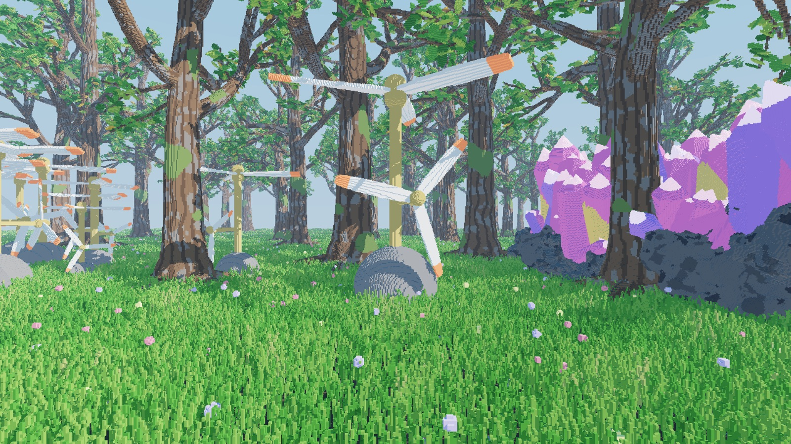

# Vanta🅱️lock

A microvoxel engine built for dense, close-up worlds: intricate vegetation and geometry, articulated animation, and a client/server architecture. Worlds are made of canonical voxel assets that are ray traced on the GPU through a BVH4 scene hierarchy and per-group 64-trees.

## Table of contents

- [Build and run the project](#build-and-run-the-project)
- [Usage guide](#usage-guide)
  - [Keybinds](#keybinds)
  - [Performance](#performance)
- [How it works](#how-it-works)

## Build and run the project

  
Nix users

Activate the [project's flake](./flake.nix) to set up the environment and all dependencies. For `direnv` users, the `.envrc` is set up to use the flake by default.

Then simply use any scripts from the `.justfile` (run `just` to list them all):

1. `just run` to compile and run the debug binary (slow)
2. `just run-fast` to compile and run the release binary (fast)

  
Other users

Compiling the project requires **Rust 1.88 or newer**.

- A `rust-toolchain.toml` is provided to ensure this for any users using `rustup` will automatically run with this version.
- Any other installation method will have to manually ensure the version 1.88 or newer.

Assuming rust is properly setup, `cargo` can be used like any standard Rust project:

- Run `cargo run --release` to compile and run in **release mode** (higher fps, optimized compilation)
- Run `cargo run` to compile and run in **debug mode** (lower FPS, debug tracing, simplified compilation)

Assets are baked from the procedural recipes in `assets/shared/vanta` on first launch and cached afterwards.

## Usage guide

### Keybinds

| Key(s)           | Action                                                       |
| :--------------- | :----------------------------------------------------------- |
| `Escape`         | Pause menu (unlocks the cursor)                              |
| `W` `A` `S` `D`  | Move                                                         |
| `Space` / `Ctrl` | Fly up / down                                                |
| `Left Shift`     | Move faster                                                  |
| `Scroll`         | Zoom                                                         |
| `F3`             | Debug menu (frame time, scene and geometry stats, GPU info)  |
| `F2` or `V`      | Cycle debug views (normals, pose frames, voxel cells, costs) |
| `F4` or `B`      | Toggle scene acceleration (template mini-BVH / flattened)    |
| `F5`             | Cycle render scale                                           |
| `F6` or `H`      | Toggle the local hierarchy (64-tree / octree)                |
| `←` / `→`        | Rewind / advance the time of day                             |
| `P`              | Pause or resume the day cycle                                |

On macOS, `F3` may be captured by Mission Control; hold `fn` or remap the function keys.

### Performance

The renderer is an early, correctness-first baseline: GPU traversal is verified against a CPU reference, and performance optimization is the next phase of work. Expect low frame rates for now; it traces at half resolution by default (`F5` changes it). `just test-gpu gpu_scene_throughput --ignored` benchmarks the traversal kernel on the real assets.

## How it works

- **Canonical assets** (`crates/engine/voxel`, `crates/engine/baker`): procedural recipes bake into sparse voxel modules plus an articulated assembly of pose groups, stored in `.vanta` files.
- **Derived geometry**: each module bakes into a deduplicated 64-way sparse tree in paged arenas, with LOD summaries; assets get template-shared mini-BVHs over their pose groups' motion envelopes.
- **Server-authoritative world**: the server places objects and owns the world clock; clients derive every pose deterministically from replicated animation parameters.
- **GPU ray tracing**: one world ray per pixel through a scene BVH4, template mini-BVHs, and group-local 64-tree DDA, writing a visibility buffer with exact integer voxel identity, then a lighting pass with shadow rays.

See [`docs/architecture.md`](./docs/architecture.md) for how the code maps onto the engine design.
